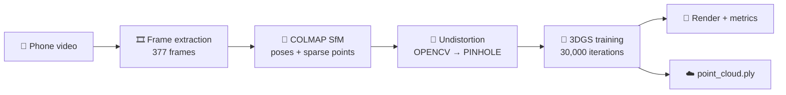

<div align="center">

# 🌍 3D Scene Reconstruction from Phone Video

### Photorealistic 3D scenes from a single handheld video using **3D Gaussian Splatting**


</div>

---

## 📖 Overview

This project turns a **phone video** into an explorable, photorealistic **3D scene**. Camera poses are recovered with **COLMAP** (Structure-from-Motion), and the scene is then optimised as a set of millions of 3D Gaussians that can be rendered quickly from new viewpoints.

Built on the official [3D Gaussian Splatting](https://github.com/graphdeco-inria/gaussian-splatting) codebase (Inria / GRAPHDECO). The core training and rendering code is theirs. The work in this repository is the **end-to-end pipeline on a custom capture**, the debugging required to run it on limited hardware, and the **quantitative evaluation**.

## 📑 Table of Contents

- [Results](#-results)
- [Pipeline](#-pipeline)
- [Capture Details](#-capture-details)
- [How to Run](#-how-to-run)
- [Challenges and Fixes](#-challenges-and-fixes)
- [Limitations and Future Work](#-limitations-and-future-work)
- [Credits and License](#-credits-and-license)

---

## 📊 Results

Evaluated on **48 held-out frames** (every 8th frame of the capture), rendered at half resolution (about 530 × 943).

| 📈 PSNR ↑ | 🧩 SSIM ↑ | 👁️ LPIPS ↓ |
|:---:|:---:|:---:|
| **33.38 dB** | **0.948** | **0.084** |

> ⚠️ **How to read these numbers:** test frames come from the same video as the training frames, so each one has very close neighbours in the training set. The scores measure reconstruction quality along the captured trajectory, not generalisation to far-away viewpoints, so they should not be compared directly with published benchmark results.

---

## 🔄 Pipeline



---

## 🎥 Capture Details

| | |
|---|---|
| 📱 **Device** | OnePlus Nord CE (handheld video) |
| 🎞️ **Frames** | 377 extracted frames |
| 📐 **SfM** | COLMAP: 377 / 377 images registered, 236,907 sparse points |
| 📷 **Camera model** | `OPENCV` from COLMAP, converted to `PINHOLE` by undistortion |
| 🖥️ **Training hardware** | Google Colab, NVIDIA Tesla T4 (15 GB) |
| ⏱️ **Training time** | about 51 minutes for 30,000 iterations |
| 🗜️ **Training resolution** | half resolution (`-r 2`) |
| 📦 **Output** | `point_cloud.ply`, 438 MB |

---

## 🚀 How to Run

<details>
<summary><b>1️⃣ Install</b></summary>

```bash
git clone https://github.com/aashvi0722/Gaussian-Splatting-Local.git
cd Gaussian-Splatting-Local

pip install plyfile tqdm
pip install submodules/diff-gaussian-rasterization --no-build-isolation
pip install submodules/simple-knn --no-build-isolation
```

A CUDA toolkit matching your PyTorch build is required. `environment.yml` holds the original reference environment.

</details>

<details>
<summary><b>2️⃣ Camera poses with COLMAP</b></summary>

Place your frames in `data/<scene>/input/`, then run:

```bash
python convert.py -s data/<scene>
```

If COLMAP produced a distorted camera model (`OPENCV`, `SIMPLE_RADIAL`, ...), undistort before training. 3DGS only accepts `PINHOLE` / `SIMPLE_PINHOLE`:

```bash
colmap image_undistorter \
  --image_path data/<scene>/input \
  --input_path data/<scene>/sparse/0 \
  --output_path <undistorted_data> \
  --output_type COLMAP

mkdir -p <undistorted_data>/sparse/0
mv <undistorted_data>/sparse/*.bin <undistorted_data>/sparse/0/
```

</details>

<details>
<summary><b>3️⃣ Train</b></summary>

```bash
python train.py -s <undistorted_data> -m output/run \
  --eval -r 2 \
  --iterations 30000 \
  --densify_grad_threshold 0.0004 \
  --test_iterations -1 \
  --save_iterations 7000 15000 30000 \
  --checkpoint_iterations 5000 7000 10000 15000 20000 25000 30000
```

`--densify_grad_threshold 0.0004` (default `0.0002`) slows Gaussian growth, which kept memory within the 12.7 GB RAM limit of the free Colab tier.

</details>

<details>
<summary><b>4️⃣ Render and evaluate</b></summary>

```bash
python render.py -m output/run --skip_train
python metrics.py -m output/run
```

Prints SSIM, PSNR and LPIPS on the held-out test views.

</details>

---

## 🛠️ Challenges and Fixes

| ⚠️ Problem | ✅ Solution |
|---|---|
| **Distorted camera model.** COLMAP gave `OPENCV`, which 3DGS rejects | Ran `colmap image_undistorter` to produce `PINHOLE` cameras |
| **Out-of-memory kills on Colab.** Full-resolution images plus Gaussian growth around iteration 7,000 exceeded 12.7 GB RAM | Half resolution, higher densification threshold, no in-training evaluation pass, background training with checkpoints |
| **Slow COLMAP matching.** CPU-bound exhaustive matching | GPU SIFT matching, cutting about an hour to under ten minutes |
| **Windows build failures** for the CUDA extensions | Built from the MSVC x64 Native Tools prompt with a matching CUDA toolkit |
| **CUDA 13 compatibility** on Colab | Added `<cstdint>` and `<cfloat>` includes and built for the T4 only (`TORCH_CUDA_ARCH_LIST=7.5`) |

---

## 🔭 Limitations and Future Work

- [x] Capture, SfM, training and evaluation on a custom phone video
- [ ] Evaluate on a separate trajectory for a fairer generalisation test
- [ ] Benchmark rendering speed (no FPS claim is made until measured)
- [ ] Interactive viewer demo and fly-through video
- [ ] Import into a game engine (e.g. Unity with a Gaussian-splat plugin) with simplified collision geometry

---

## 🙏 Credits and License

Based on **3D Gaussian Splatting for Real-Time Radiance Field Rendering** by Kerbl, Kopanas, Leimkühler and Drettakis (SIGGRAPH 2023).
Original code: https://github.com/graphdeco-inria/gaussian-splatting

The original code is released under the Inria / MPII **non-commercial research license** (see `LICENSE.md`). This project inherits those terms and is intended for non-commercial research and educational use.

<details>
<summary>📚 Citation</summary>

```bibtex
@Article{kerbl3Dgaussians,
  author  = {Kerbl, Bernhard and Kopanas, Georgios and Leimk{\"u}hler, Thomas and Drettakis, George},
  title   = {3D Gaussian Splatting for Real-Time Radiance Field Rendering},
  journal = {ACM Transactions on Graphics},
  number  = {4},
  volume  = {42},
  month   = {July},
  year    = {2023},
  url     = {https://repo-sam.inria.fr/fungraph/3d-gaussian-splatting/}
}
```

</details>

<div align="center">

⭐ If you found this useful, consider starring the repo.

</div>
